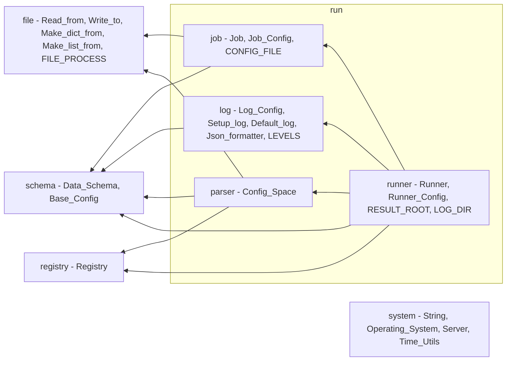

# python_toolbox

범용 Python 유틸리티 - dataclass 직렬화, 설정, 파일 입출력, 등록 검증, 작업 실행

## 구조

계층 셋. 아래 계층은 서로 모름. `run/log`, `run/parser`, `run/job` 은 아래를, `run/runner` 는 `run/parser`, `run/job`, `run/log` 와 아래를 앎.

- `Data_Schema` 는 저장용 dict(`Serialize`, 중첩 유지)와 호출용 dict(`Extract`, 평탄)를 가름
- 설정(`Base_Config`)은 dict 로 초기화만. 파일, argv 를 모름 - 읽고 쓰는 것은 실행 쪽 몫
- 설정 값은 `Config_Space` 한 공간에 경로 key 로 펼쳐 둠. 공용 값은 한 곳에 두고 `${경로}` 로 참조, 참조는 짓는 때(`Build`) 풂 - 나중에 덮어쓴 값이 모든 참조에 반영됨
- argv 덮어쓰기는 공간에 있는 경로만 - 없는 경로는 오류
- 필드 타입이 설정(`X`, `X | None`, `list[X]`)이면 `Build` 가 그 값도 설정으로 지음 - 설정 타입 필드에 dict 가 남지 않음
- runner 설정은 공간의 root 전체. 하위 설정(model, loss 등)은 runner 설정의 설정 필드로 선언 - 놓는 경로가 곧 필드 이름
- `Runner` 사용처는 `config` 타입만 선언해 좁힘. `Runner` 가 그 annotation 을 읽어 지음
- argv 하나로 파일과 덮어쓰기를 함께 받음 - `=` 가 있으면 덮어쓰기, 없으면 파일, `path@at` 의 `at` 은 놓을 경로
- job 설정은 runner 설정의 하위 필드 `job`(`Job_Config`) - 설정을 다 지은 뒤 그 값으로 클래스를 부름, job 클래스가 설정 타입을 안 정함
- job 은 runner 의 멤버. `config.job.object_type` 으로 `JOB_REGISTRY` 에서 불러 생성 때 `(config, result_dir)` 로 지음 - job 은 runner 를 모름
- 설정은 registry 하나(`CONFIG_REGISTRY`). 다른 registry(모델, loss 등)는 job 이 안에서 씀 - runner 가 모름
- `Runner` 는 job 관리만 - 설정을 짓고 job 을 고르고 짓고 돌림. 설정 파일을 안 남김 - 남길 것은 job 이 정함
- 결과 자리는 job 결과 폴더들의 부모 - `Make_result_dir` 한 자리가 정하고 만듦. 기본 `RESULT_ROOT/<project_name>`, 사용처가 override
- 실행마다 새 폴더 없음 - job 결과 폴더는 job 이 결과 자리 아래에 만듦(`Make_run_dir`). 이어 쓸 폴더는 job 설정의 `resume`
- job 결과 폴더에 자기 job 설정(`CONFIG_FILE`)을 남김. 이어서 할 때 그 값과 자기 job 설정을 비교 - 다르면 멈춤
- 비교는 job 마다 자기 설정만, 남은 값에 있는 것만 - `resume`, `config_type`, `object_type` 은 밖. runner 설정 전체를 안 봄
- `Run` 은 기록 설정, job 실행 차례. 기록은 결과 자리 아래 `LOG_DIR`
- 진입은 `Runner.From_argv` 하나 - job 마다 CLI 를 두지 않음. `Run` 의 참, 거짓이 종료 코드
- job 이 쓰는 객체(모델, loader 등)는 job 안에서 지음 - DDP 처럼 worker 마다 짓는 경우도 같은 틀
- `Runner` 는 파일보다 먼저 설정 클래스의 기본값을 공간에 깜(`Load_schema`) - 선언된 필드는 파일에 없어도 argv 로 덮어씀, 선언 밖 경로는 오류
- 기록은 표준 logging 그대로 - 기록하는 쪽은 `logging.getLogger(이름)` 만, 설정은 진입점(`Runner.Run`)이 `Setup_log` 한 번
- logger 마다 수준과 출력 위치(`console`, `LOG_DIR` 안의 `.log` text / `.jsonl` JSON Lines). 지표 같은 종류는 logger 이름으로 가름
- 따로 설정한 logger 는 `root` 출력으로 다시 흐르지 않음 - 한 줄이 두 번 남지 않음
- 파일 포맷은 확장자로 디스패치. 새 포맷은 `FILE_PROCESS` 에 처리기 등록 하나로 끝남
- `Registry` 는 잘못된 상속, Callable 시그니처 불일치를 등록 시점에 막음
- job 의 진행, 결과, 실패는 모두 logging 으로 남김 - 따로 event 없음
- job 의 실패는 그 job logger(`job.<클래스 이름>`)와 하위 logger 의 ERROR 기록 수. 예외도 `log.exception` 으로 남겨 실패로
- job 은 스레드를 모름 - 따로 돌릴지는 부르는 쪽 몫. 멈춤은 요청만, `Work` 가 `stopped` 를 보고 끝냄
- 키마다 반복, 워커 풀 같은 실행 방식은 사용처가 `Job` 위에 얹음 - 바탕에 두지 않음
- 폴더는 묶는 기준이 있을 때만 - `run/` 은 한 번의 실행, `file/` 은 디스패치 하나 뒤의 포맷 처리기
- `run/` 은 다시 내보낼 것이 없어 `__init__.py` 없음 - 모듈까지 적어 import

## 기반

| 무엇 | 종류 | 쓰는 곳 |
| --- | --- | --- |
| `Data_Schema` | dataclass 부모 | 직렬화가 필요한 데이터 |
| `Base_Config` | `Data_Schema` 파생 부모 | 설정 |
| `File_Process` | 추상 클래스 + `FILE_PROCESS` 등록 | 새 파일 포맷 |
| `Registry` | 등록표 | 이름으로 클래스, Callable 을 고름 |
| `Job` | 작업 바탕 - `(config, result_dir)`, `Work` 구현, job 결과 폴더(`Make_run_dir` override) | runner 가 돌릴 작업 |
| `Job_Config` | `Base_Config` 파생 부모 - `object_type`(job key), `resume` | job 설정 |
| `Runner_Config` | `Base_Config` 파생 부모 - `project_name`, `job`, `log`, `shared` | 실행 진입점의 설정 |
| `Runner` | 실행 바탕 - 설정 공간, 결과 자리(`Make_result_dir` override) | 실행 진입점 |

## Workflow

| 대상 | 목적 | 추가 의존 |
| --- | --- | --- |
| `pip install -e .` | 패키지 설치 | `pyyaml`, `python-dateutil` |
| `pytest` | `tests/` 흐름 테스트 | `dev` extra |
