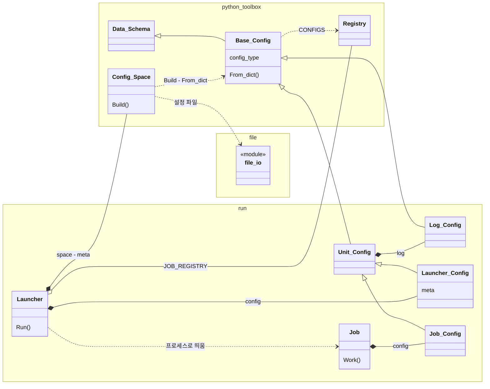

# python_toolbox

범용 Python 유틸리티 - dataclass 직렬화, 설정, 파일 입출력, 등록 검증, 작업 띄우기와 실행, 기록

## 구조

계층 셋 - `schema`, `file`, `registry` <- `config` <- `run/`. 같은 계층은 서로 모름. `run/` 안은 log <- unit <- job <- launcher.

- 설정의 목표 - 파일, argv 로 meta 를 만들고 참조로 다른 값을 가져와, 필요한 설정 하나를 지음. hydra 와 비슷한 기능
- 설정 둘 - launcher 설정과 meta(job 설정들). meta 는 `Config_Space` 가 들고 job 설정을 지음
- Launcher 는 준비와 띄우기까지 - `Run` 때 job 설정을 짓고 job 클래스를 고르고 job 을 띄움. 그 뒤(일, 결과 폴더, 실패 판단)는 job
- 기록은 가진 쪽이 듦 - job 기록은 job 의 선언(`config.log`), Launcher 기록은 띄움과 결과만
- 폴더는 묶는 기준이 있을 때만 - `run/` 은 한 번의 실행, `file/` 은 디스패치 하나 뒤의 포맷 처리기
- `__init__.py` 는 다시 내보낼 것이 있는 `file/` 에만 - 나머지는 namespace package, 모듈까지 적어 import

결정

- `Registry` 와 `Config_Space` 를 합치지 않음 - 담는 것(코드 / 데이터), 채워지는 때(import / 실행), 같은 key(실패 / 덮어씀)가 반대

## 기반

| 무엇 | 종류 | 쓰는 곳 |
| --- | --- | --- |
| `Data_Schema` | 부모 - 직렬화 | 저장할 데이터 |
| `Base_Config` | 부모 - 설정. 하위 클래스는 `CONFIGS.Register_module(key)` 로 등록 | 설정 |
| `Unit_Config` | 부모 - 기록 선언, 정체성. 뺄 칸은 `__exclude_identity__` 에 더함 | job 이 짓는 객체의 설정 노드 |
| `Job_Config` | 부모 - job 설정 | 사용처 job 의 설정 |
| `Job` | 부모 - `Work` 구현, override `Outcome`, `Make_run_dir` | 사용처 job |
| `Launcher_Config` | 부모 - 자기 칸을 더함 | 사용처 진입점의 설정 |
| `Launcher` | 부모 - `config` 타입, `JOB_REGISTRY` 선언, override `Make_base_dir` | 사용처 진입점 |
| `File_Process` | 부모 - 처리기, `FILE_PROCESS` 에 등록 | 새 파일 포맷 |

## Workflow

| 대상 | 목적 | 추가 의존 |
| --- | --- | --- |
| `pip install -e .` | 패키지 설치 | `pyyaml`, `python-dateutil` |
| `pytest` | `tests/` 흐름 테스트. job 클래스는 `tests/support/` - spawn 자식이 다시 import | `dev` extra |
