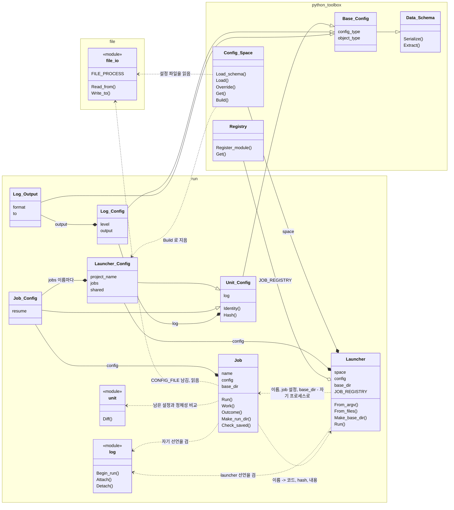

# python_toolbox

범용 Python 유틸리티 - dataclass 직렬화, 설정, 파일 입출력, 등록 검증, 작업 띄우기와 실행, 기록

## 구조

계층 셋. 아래 계층은 서로 모름. 맨 위는 schema <- config(file, registry 도 앎), `run/` 안은 log <- unit <- job <- launcher.

- 설정 트리는 재귀 - launcher 설정이 root, 그 아래 `jobs`, 그 아래 job 이 짓는 객체. 노드마다 `Unit_Config` 같은 꼴
- Launcher 는 준비와 띄우기까지 - 설정을 짓고 job 클래스를 고르고 job 을 띄움. 그 뒤(일, 결과 폴더, 실패 판단)는 job
- 기록은 가진 쪽이 듦 - job 기록은 job 의 선언(`config.log`), Launcher 기록은 띄움과 결과만
- 폴더는 묶는 기준이 있을 때만 - `run/` 은 한 번의 실행, `file/` 은 디스패치 하나 뒤의 포맷 처리기
- `__init__.py` 는 다시 내보낼 것이 있는 `file/` 에만 - 나머지는 namespace package, 모듈까지 적어 import

결정

- 설정은 dict 로 초기화만 - 파일, argv 를 모름. 읽고 쓰는 것은 실행 쪽
- 정체성에 `config_type`, `object_type` 을 넣음 - 고른 클래스가 결과를 바꿈
- 처음부터 비동기, job 마다 `spawn` 프로세스 - 부모 상태를 안 물려받아 job 은 받은 것만 앎
- job 이름은 `jobs` 의 key - `object_type` 은 설정 안의 값이라 가르는 key 가 못 됨
- 결과 코드는 부호로 갈래 - 0 정상, 양수 실패, 음수 멈춤. 신호로 끊긴 `exitcode`(-N)와 같은 쪽
- Launcher 는 설정 파일을 안 남김 - 남길 설정은 결과 폴더를 아는 job 이 남김
- 선언한 logger 의 거르기는 handler 에서, `propagate` 는 그대로 - 아래에 선언이 있어도 위쪽 실패 세기가 다 봄
- 키마다 반복, 워커 풀 같은 실행 방식은 사용처가 `Job` 위에 얹음 - 바탕에 두지 않음

## 기반

| 무엇 | 종류 | 쓰는 곳 |
| --- | --- | --- |
| `Data_Schema` | 부모 - 직렬화 | 저장할 데이터 |
| `Base_Config` | 부모 - 설정 | 설정 |
| `Unit_Config` | 부모 - 기록 선언, 정체성. 뺄 칸은 `__exclude_identity__` 에 더함 | job 이 짓는 객체의 설정 노드 |
| `Job_Config` | 부모 - job 설정 | 사용처 job 의 설정 |
| `Job` | 부모 - `Work` 구현, override `Outcome`, `Make_run_dir` | 사용처 job |
| `Launcher_Config` | 부모 - `jobs` 값 타입을 좁힘 | 사용처 진입점의 설정 |
| `Launcher` | 부모 - `config` 타입, `JOB_REGISTRY` 선언, override `Make_base_dir` | 사용처 진입점 |
| `File_Process` | 부모 - 처리기, `FILE_PROCESS` 에 등록 | 새 파일 포맷 |

## Workflow

| 대상 | 목적 | 추가 의존 |
| --- | --- | --- |
| `pip install -e .` | 패키지 설치 | `pyyaml`, `python-dateutil` |
| `pytest` | `tests/` 흐름 테스트. job 클래스는 `tests/support/` - spawn 자식이 다시 import | `dev` extra |
