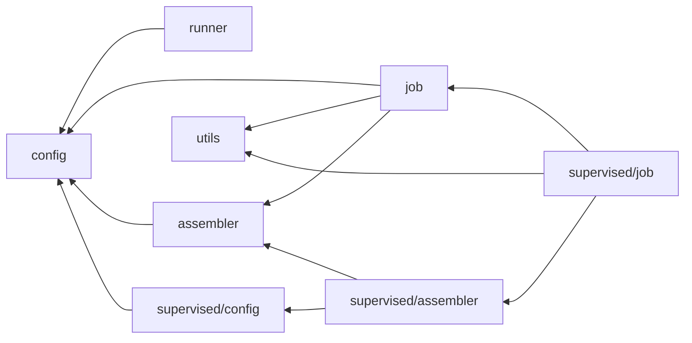

# runner

학습, 평가, export 실행. python_toolbox `Runner` 가 설정과 결과 자리를, job 이 일을, assembler 가 프로세스 안의 조립을 맡음.

## 구조

| 자리 | 아는 것 | 모르는 것 |
| --- | --- | --- |
| `config.py` | `Torch_Config` - 장치(`gpus`, DDP 주소), 반복, 가중치(`weight_path`, `start_iter`), `test`, AMP, grad clip, mode 별 `Mode_Config`(loader, metric, batch_monitoring), `Export_Config` | model, loss, optim 의 종류 |
| `runner.py` | `Torch_Runner` - 하위 설정 registry `CFGS` | 루프, 조립 |
| `job.py` | `Torch_Job` - run 폴더(`Make_run_dir`), 프로세스 문맥(장치, DDP, 가중치 고르기, 조립). `Learning_Job` - GPU 마다 프로세스, iteration 반복, 체크포인트, 멈춤. `Export_Job` - 프로세스 하나, ONNX, `_rt_cfg.yaml` | 컴포넌트가 무엇인지 - assembler 가 dict 로 줌 |
| `assembler.py` | `Component_Assembler` - 지은 설정으로 mode 별 dataset, dataloader, metric. `train` mode 만 기울기 | 도메인 컴포넌트 - 하위가 `_Build` 로 |
| `supervised/` | `Supervised_Config` - model, loss, optim 하나씩. `Supervised_Assembler` - 조립, 차원 context, 체크포인트 되살리기. `Supervised_Learning_Job` - iteration 갈고리 고정, 사용처는 `_Forward` 하나 | 다른 학습 형태 |
| `utils/` | 지표 기록(`metric` logger, `avg/` json), 가중치 고르기(`Iter_Selection`, `Resolve_weight_path`), 분산 metric 평균 | runner, job 클래스 |

- 방향 : `config`, `runner`, `job`, `assembler` 는 `modules`, `optim` 을 모름. `supervised/` 만 import
- job 하나가 일 하나 - `learning`(train / val, `test=true` 면 test 만), `export`. 사용처가 job 을 상속해 `JOB_REGISTRY` 에 등록, 고르기는 `job.object_type`
- 객체(model, loader 등)는 job 의 프로세스 안에서 assembler 가 지음 - DDP 는 GPU 마다 따로 지어야 함
- job 결과 폴더는 run 폴더 - python_toolbox `Job.Make_run_dir`. 이어서 할 때 남은 job 설정과 비교. 체크포인트, `avg/` json, export 산출물이 run 폴더
- DDP 자식은 `(job 클래스, 설정, 결과 자리, run 폴더)` 로 job 을 다시 지음 - 부모의 run 폴더를 받음, 멈춤 신호는 프로세스로 못 넘김
- 기록은 logging, 결과 자리의 `log/` - 자식은 rank 0 만 설정의 `log` 대로. iteration 지표는 `metric` logger 와 `avg/` json, json 은 체크포인트 고르기가 읽음
