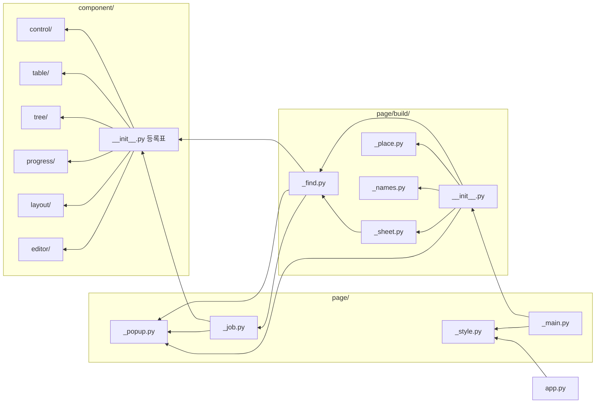

# ui_toolbox - Qt 부품

도메인 0. 값의 뜻을 안 묻는 component 와, config 로 그것을 짓고 놓는 page.

인자 · 반환은 심볼의 docstring, config 의 칸 규칙은 [`page/build/__init__.py`](ui_toolbox/page/build/__init__.py) 머리.

---

## 구조



| 자리 | 아는 것 | 모르는 것 |
| --- | --- | --- |
| [`component/`](ui_toolbox/component) | 값 하나, 행 목록, 문서, 영상 편집, 자식 배치. 등록표 - 클래스 이름 -> 클래스 | 값의 뜻, config, page |
| [`page/build/`](ui_toolbox/page/build) | config node -> 위젯 - node 검사, `link` · `action` · `items` 차례로 짓기, 영역 이름 검사(`__init__.py`). 이름 -> 클래스, 배치인가(`_find.py`), 배치 걸기(`_place.py`), key 묶음(`_names.py`), style 덮기와 QSS(`_sheet.py`) | 상태, 연결, component 하나하나 |
| [`page/_popup.py`](ui_toolbox/page/_popup.py) | 창 하나 - `modal`, `result`, 크기, 확인 / 취소 줄 | 본문이 무엇인가 |
| [`page/_job.py`](ui_toolbox/page/_job.py) | 작업의 콜백 -> Qt 신호(GUI 스레드), 진행 막대 · 상태 줄 · 로그 · 멈춤 · 잠금 | 일이 무엇인가, 어떻게 도는가 |
| [`page/_main.py`](ui_toolbox/page/_main.py) | root page - config 를 central widget 에, root 묶음, 닫힐 때 멈출 것 | 상태, 입력의 뜻, 연결 |
| [`page/_style.py`](ui_toolbox/page/_style.py) | 토큰 -> palette · 공통 style 객체 | 어느 위젯이 무엇인가 |
| [`app.py`](ui_toolbox/app.py) | 앱 수명 - palette, page 띄우기, 루프 | 무엇을 띄우는가 |

- 방향 `component` <- `page` <- `app`. 아래는 위를 모름
- `page/` 바로 아래는 page 구성 셋(`Main`, `Popup`, `Job_popup`)과 공통 style, 짓는 과정은 `page/build/`. build 는 link 에 지을
  popup 클래스를, `Main` 은 `Fill` 을 앎 - 파일로는 한 방향
- component 끼리 안 씀 - control, table, tree 는 자료형을 다루는 형제

결정

- 범주 이름 `component` - Qt 에서는 page 도 `QWidget`, Qt 기반 클래스 이름과 안 겹치게
- component 는 공통 기본 객체 없음 - 각자 Qt 클래스를 상속. control 계약은 이름 셋(`value`, `set_value`, `value_changed`)
- control - 위젯 하나면 Qt 클래스를 바로 상속, 여럿이면 `QWidget` + layout. 라벨 안 듦 - 배치가 붙임. `set_value` 는 신호 안
  냄 - 복원과 사람의 편집을 가름
- table - 보기는 `QTreeView` 에 펼침 표시만 끔 - `QTableView` 만의 것(격자, 칸 단위 선택, 행 번호)을 쓰는 곳 없음. 정렬, 거르기는
  model 이 보이는 순서를 직접 듦 - proxy 로는 정렬 사슬과 머리글 표시를 어차피 직접 짬
- 등록표는 python_toolbox `Registry` - key 는 클래스 이름 그대로(`register`). 기본 소문자 key 는 config 가 못 찾음
- config 는 배치와 style 선언까지, 연결(멤버 <-> 상태, action)은 소비처 Python 이 key 경로로 - config 에 action 이름 없음
- build 층 없음 - `page/build/` 는 page 의 config 처리 도구 하나. container 클래스 없음 - `class` 가 배치(`QLayout`, `QSplitter`,
  `QTabWidget`, `add(child, title)` 계약의 위젯)
- page 가 component 를 아는 길은 등록표 하나 - 배치인가도 클래스가 아니라 `add(child, title)` 계약으로 봄. `layout/` 에 배치가
  늘어도 build 는 안 바뀜
- 설정 구조 하나 - root 부터 끝까지 같은 node 꼴. 형식은 자체 config(dict, yaml 은 그 꼴 중 하나) - Qt Designer `.ui` 아님
- key 하나가 역할 이름 - `objectName`, style selector, 경로. 따로 역할 이름 없음
- 배치에 안 드는 것은 칸으로 가름 - popup 은 `link`, `QAction` 은 `action`. `items` 는 배치에 드는 것만
- 자식은 묶음(`.items`) 아래, 찾기는 경로(`items.find("a.b")`) - 위젯 속성에 두면 Qt 이름(`size`, `close`, `x`)과 자주 부딪힘
- style 은 build 가 객체로 넘김 - Qt 시트는 속성 값(font, color 밖)을 자식에 안 물림. 같은 key 는 같은 style - CSS 와 같음
- config 덮어쓰기 없음 - 덮을 lib 원본 config 가 없음. 공통 style 은 `Fill` 의 `style` 인자(`Main` 이 깖)
- 독립 창 없음 - root main 하나, 나머지는 모두 popup. page 등록 없음 - Python 클래스는 소비처의 root page 하나
- 작업을 돌리는 것(스레드, 프로세스, 출력 줄 규약)은 UI 일이 아님 - python_toolbox `project.job`. 여기는 진행을 GUI 스레드로
  넘겨 보이기만, 작업은 계약(`on`, `start`, `stop`, `running`)으로만 앎 - UI 를 모르는 작업 프로그램도 같은 규약을 씀
- 토큰 하나에서 palette 와 공통 style 이 나옴 - `app.Run` 이 같은 토큰을 page 를 짓는 콜러블에 넘김. 색이 두 곳에 안 삶
- component 는 "이 칸을 열어 달라" 신호(`open_requested`)만 - 영역 이름은 여는 쪽 config 가 적고, 받는 영역은 출처를 모름.
  영역은 같은 page 의 `items` key 또는 보이는 `link` key - `link` 에 있으면 popup
- 영역 이름은 지을 때 검사 - component 가 `regions()` 로 알림. build 가 component 인자 꼴을 안 앎
- component 가 든 UI 조각(`Table_view` 우클릭 메뉴, `Raster_editor` 의 `toolbar`, `options`)은 component 의 것 - config 가 안
  건드림. 메뉴 항목은 소비처마다, 때마다 바뀜 - 소비처가 `menu` 에 넣고 뺌. 조각의 자리는 생성자 인자
- 치수는 config 가 듦 - 크기, 색은 style 의 QSS. 간격처럼 QSS 가 안 닿는 값은 그 값을 쓰는 클래스만 생성자 인자로(`QLayout` 의
  `spacing`)
- container 는 접근 범위 - 부모는 자식을 알고, 자식은 부모 · 형제를 모름. container 끼리의 연결은 둘을 다 아는 page
- 근거 - 소비처 셋(part_canon, recognizer_viewer, mask_review)에 같은 배선 반복(작업 실행 흐름, 목록과 상세, 대화상자 사유 줄).
  내용(무엇을 어디에)은 소비처, 적는 수단은 여기 - 도메인 0 을 안 깸

## 기반

| 무엇 | 갈래 | 쓰는 자리 |
| --- | --- | --- |
| [`register`](ui_toolbox/component/__init__.py) | 등록표 - 클래스 이름 -> `QWidget` 하위 클래스 | config 의 `class`, 소비처 component |
| control 이름 셋 | 계약 - `value`, `set_value`(신호 없음), `value_changed` | control 열넷 |
| `regions()` | 계약 - `open_requested` 가 낼 영역 이름 | `Table_view`, `Tree_view` -> build 검사 |
| `add(child, title)` | 계약 - 자식 여럿을 제 방식으로 놓음 | [`Fold`](ui_toolbox/component/layout/_fold.py) |
| [`Editor_base`](ui_toolbox/component/editor/_base.py) · `Draw_tool` · `Tool` | 골격 - 도구 선언 -> 툴바 · 단축키, 신호는 차원 `D` 를 안 가림 | `Raster_editor` |
| [`Main`](ui_toolbox/page/_main.py) | 골격 - root page. `find`, `on_close` | 소비처 page 가 상속 |
| [`Fill`](ui_toolbox/page/build/__init__.py) | 짓기 - root node 를 이미 지은 위젯에 채움 | `Main` |
| [`Tokens`](ui_toolbox/page/_style.py) · `Palette` · `Base` | 토큰 -> palette · 공통 style 객체 | `app.Run`, `Main` |
| [`Names`](ui_toolbox/page/build/_names.py) | 묶음 - key -> 객체, `find` 경로 | `.items`, `.link`, `.action` |
| [`Popup`](ui_toolbox/page/_popup.py) | 골격 - `body` + 확인 / 취소 줄 | `link` 의 배치 class, `Job_popup` |
| 작업 계약 | 계약 - `on(event, fn)`(`start`, `progress`, `line`, `finish`), `start`, `stop`, `running` | python_toolbox `project.job` -> [`Job_signals`](ui_toolbox/page/_job.py), `Job_popup.run` |

## 워크플로

| 타깃 | 담는 것 | 더 무는 것 |
| --- | --- | --- |
| `component` | control, table, tree, progress, layout, editor, 등록표 | numpy(editor), python_toolbox(`Registry`) |
| `page` | build, main, popup, 공통 style | python_toolbox(`file` - yaml) |
| `app` | 앱 수명 - `Run` 하나 | - |

- 모두 PySide6. 빌드는 [`pyproject.toml`](pyproject.toml) 하나 - 무는 것을 갈래로 안 가름
- python_toolbox 는 같은 저장소의 `HUB` 에서 받음
- 실행 진입은 `app.Run` 하나 - `Run(lambda t: My_page("page.yaml", tokens=t))`
- test 는 `dev` 옵션 하나(`pytest`). 화면 없이 도는 것은 [`test/conftest.py`](test/conftest.py) 소유

```bash
pip install git+https://github.com/DXR-keonghun6612/ToolBox.git@HUB#subdirectory=ui_toolbox
pip install -e ".[dev]" && python -m pytest test -q
```
